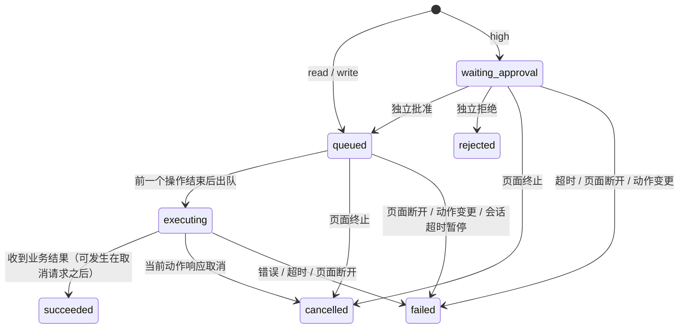

# 网站开发者接入指南

ClearAct 把网站已有的业务能力注册成结构化动作。React/Vue 适配负责组件生命周期，core 管理动作与页面连接，observer 显示操作记录，broker 管理审批与一次性执行凭据，MCP 桥接本地 Codex。现有业务 API 的身份验证和权限检查仍由网站负责。

## 1. 选择动作边界

先选 3～5 个短动作，例如查询任务、创建任务、修改任务、删除任务。一个动作应对应一个可独立说明和验证的业务结果，不需要把每个按钮都暴露成工具。

| 字段 | 开发者应提供的内容 |
| --- | --- |
| `name` | 稳定且唯一的业务动作名，例如 `orders.delete` |
| `description` | 适用场景、对象范围、前置条件、具体影响；避免只复述函数名 |
| `inputSchema` | 明确字段类型、必填项、枚举和 `additionalProperties: false` |
| `risk` | `read` 查询；`write` 普通修改；`high` 必须独立审批的操作 |
| `execute` | 调用既有 API，完成后返回可验证的结构化结果 |
| `target` | 可选 CSS selector，用于页面上标示操作区域 |

`risk` 来自开发者注册，Agent 不能在每次调用中降低风险等级。描述可以帮助模型理解，但不能代替服务端授权。

## 2. 创建页面 runtime

本地包构建和安装见 [SDK 包说明](PACKAGES.md)。以下示例中的 API 路径由宿主应用实现。

```ts
import { createClearActRuntime, type ClearActAction } from '@clearact/core';

export const runtime = createClearActRuntime({
  sessionId: 'orders-page',
  serverUrl: 'http://127.0.0.1:4310',
  context: { page: '订单列表', scope: '当前登录用户有权访问的订单' },
});

export const listOrders: ClearActAction = {
  name: 'orders.list',
  description: '查询当前用户可访问的订单，返回编号、标题和状态。',
  risk: 'read',
  target: '#orders-table',
  inputSchema: { type: 'object', additionalProperties: false },
  async execute() {
    const response = await fetch('/api/orders');
    if (!response.ok) throw new Error(`订单查询失败：${response.status}`);
    return response.json();
  },
};
```

同一 broker 中 `sessionId` 标识一个页面连接；两个同时打开的页面不要使用相同 ID。MVP 的固定 `kan` / `vikunja` 只适用于单页面验收。不要把登录凭据放进 `context`、action 描述或返回结果。

## 3. React / Vue 生命周期

React：Provider 管理连接，hook 管理动作注册。页面退出时注销动作；最终销毁 runtime 时调用 `dispose()`。

```tsx
import { ClearActProvider, useClearActAction } from '@clearact/react';
import { runtime, listOrders } from './agent';

function OrdersPage() {
  useClearActAction(listOrders);
  return <div id="orders-table">{/* 原有订单页面 */}</div>;
}

export function App() {
  return <ClearActProvider runtime={runtime}><OrdersPage /></ClearActProvider>;
}
```

Vue：在应用入口安装 plugin，再在页面组件 `setup` 中注册。

```ts
// main.ts
import { createClearActPlugin } from '@clearact/vue';
app.use(createClearActPlugin(runtime));
// 应用最终销毁时，宿主负责 runtime.dispose()。
```

```vue
<script setup lang="ts">
import { useClearActAction } from '@clearact/vue';
import { listOrders } from './agent';
useClearActAction(listOrders);
</script>
<template><div id="orders-table"><!-- 原有订单页面 --></div></template>
```

业务状态变化时调用 `runtime.setContext()`，提供简短、必要且最新的信息；不要持续复制整个 DOM。动作在组件卸载时从发现列表移除，已经开始的原生调用仍等待真实结果。注销本身不撤销业务写入。

## 4. 高危动作必须有后端关口

```ts
runtime.registerAction({
  name: 'orders.delete',
  description: '永久删除指定订单。必须等待独立操作者批准；拒绝后不删除。',
  risk: 'high',
  target: '#orders-table',
  inputSchema: {
    type: 'object',
    properties: { id: { type: 'string', minLength: 1 } },
    required: ['id'],
    additionalProperties: false,
  },
  async execute(args, execution) {
    const response = await fetch(`/api/orders/${encodeURIComponent(String(args.id))}`, {
      method: 'DELETE',
      headers: {
        'X-ClearAct-ClearActOperation-Id': execution.operationId,
        'X-ClearAct-Execution-Token': execution.executionToken!,
      },
    });
    if (!response.ok) throw new Error(`删除失败：${response.status}`);
    return response.json();
  },
});
```

宿主后端先按原逻辑认证并检查用户是否有权删除，再向可信 broker 发起 `POST /api/verify-execution`：

```ts
const verification = await fetch('http://127.0.0.1:4310/api/verify-execution', {
  method: 'POST',
  headers: {
    'Content-Type': 'application/json',
    Authorization: `Bearer ${executionTokenFromRequest}`,
  },
  body: JSON.stringify({
    operationId: operationIdFromRequest,
    sessionId: 'orders-page',
    action: 'orders.delete',
    arguments: { id: normalizedOrderId },
  }),
});
if (!verification.ok) throw new Error('缺少有效审批，禁止删除');
// 成功消费一次性凭据后，才执行原有删除操作。
```

动作参数和后端校验参数必须完全一致。请求 ID、执行凭据、动作名、会话、完整参数联合绑定；同一凭据不能重复消费。请求路径应先规范化或拒绝非规范表示，不能因为路径编码导致校验分支被跳过。所有等价写入入口都需要同样的关口；本 MVP 只保护所选的删除入口，具体缺口见两个 integration README。

凭据一经消费，后续业务失败也不能直接重放。`failed` 或网络超时不代表业务已回滚：先通过原 API 核对状态，再决定是否发起新的操作。

## 5. 页面可观测与独立审批

```ts
import { mountClearActObserver } from '@clearact/observer';

const unmountClearActObserver = mountClearActObserver(runtime, undefined, {
  theme: 'auto', // 默认；也可指定 'light' 或 'dark'。
  async describeOperation(operation) {
    if (operation.action !== 'orders.delete') return operation.action;
    const response = await fetch(`/api/orders/${encodeURIComponent(String(operation.arguments.id))}`);
    if (!response.ok) throw new Error('无法读取待审批订单');
    const order = await response.json();
    return `订单 ${order.id} · ${order.title} · 金额 ${order.amount}`;
  },
});
// 页面销毁时调用 unmountClearActObserver()。
```

无色透镜顶岛在桌面展开约 600 × 64px，当前操作使用自然叙述，长意图单行省略并通过完整提示保留原文。展开态内置短连续操作频率滑块、历史入口和醒目的 Shut Down，窄视口下控件可以换行。拖动 ClearAct 标识、叙述或空白处可移动顶岛，也可聚焦标识后用方向键移动；位置随视口变化保持在页面内。收起时变形为浏览器内容顶部中央的薄弧，只保留轨道游标入口；点击展开会恢复原位置。新审批到来时自动展开，审批内容可滚动，停止控件保留在头部。

历史默认关闭，仅为已结束操作显示紧凑节点。点击“历史”再手动选择一个节点，才展开这一条记录的意图、参数与真实结果；查看历史不替换当前操作，已展开详情会保持到用户关闭。

可选的 `theme` 为 `'auto' | 'light' | 'dark'`，省略时默认 `'auto'`。自动模式依据宿主页背景适配明暗文字；图片或复杂混合背景可显式指定主题，例如 `mountClearActObserver(runtime, undefined, {theme: 'dark'})`。

使用 `describeOperation` 时，对象读取完成前“批准执行”不可用，失败时可重试；拒绝不需要等预览加载。预览是帮助操作者识别对象的只读信息，不是数据库版本锁。

只读观察页面不需要审批 token。人工审批入口必须由独立操作者向 runtime 的 `approvalToken` 选项提供凭据；测试脚本通过独立进程模拟这一身份。不要把审批 token 交给 MCP、模型、公开页面变量或 URL。当前演示页面的 sessionStorage 注入方式只适用于受控本地环境；任意同源脚本或完全控制浏览器的 Agent 都不在此隔离边界内。

`intent` 必填，长度为 1–2000 字符。Agent 应用一句简短自然语言说明正在做的动作、目标和它如何推进用户请求，例如“我正在核对这笔订单的状态，确认它是否可以发货。”，避免提前宣称成功。顶岛直接显示脱敏后的 `intent`；它是 Agent 提交的行动依据，不等于经过验证的模型内部推理。执行结束后，真实返回值在历史详情中展示。

原生 WebMCP 发现到的工具输入为 `{intent, arguments}`，其中 `arguments` 的 schema 与注册动作的业务 schema 一致，保留文档内引用。原生调用缺少意图或传入非对象参数时会在创建操作前拒绝。`execute(args, context)` 仍只接收业务参数，意图通过 `context.intent` 传递。MCP 的 `invoke_action` 及 `runtime.invoke(action, args, intent, requestId)` 格式保持不变。

### 私密输入

在 action 的 `inputSchema` 中用 `writeOnly: true` 标记私密字段。业务函数仍接收原值；操作记录和 Observer 只接收 `[REDACTED]`，字符串原值在返回结果、错误和意图中的直接回显也会遮蔽。不要把凭据写入 action 描述或 `intent`。

投影会保守合并 schema 分支中的私密标记，支持本 schema 文档内的递归引用、JSON Pointer、具名引用和嵌套 `$id`；无法解析的引用会遮蔽对应输入整体，不会加载外部 schema。结果按 JSON 的 `toJSON` 语义处理，日期保留 ISO 字符串。回显过滤仅匹配非空字符串原值，不能识别凭据的编码、摘要或业务侧另存副本；业务实现仍应只返回所需的公开数据。

### 可见动作与终止

Observer 默认启用 24 × 32px 的白色细箭头，以深色细描边适配深浅背景。动作启动后先定位 `target`，以 400～650ms 的动画移到目标，再执行注册的业务函数；顶岛叙述使用本次 Agent 意图，状态标记区分定位与执行。墨绿四角锁定框只围住当前目标，准备、执行时显示，待审批时采用静态琥珀色，操作结束后隐藏。锁定框跟随滚动和目标布局变化，不修改业务元素样式、不拦截点击。没有全页面罩或视口边框。指针在动作完成后停留 10 秒，再用 300ms 淡出；下一动作会取消停留或淡出，从上次坐标继续移动。终止、断线、后台页面及减少动态效果会立即清除指针。

`target` 应指向当前业务对象对应的页面元素。可以通过 `resolveTarget` 按参数定位具体对象；这只负责显示位置，不改变业务对象验证与权限检查：

```ts
const unmount = mountClearActObserver(runtime, undefined, {
  resolveTarget(operation) {
    if (operation.action !== 'orders.update') return null;
    return document.querySelector<HTMLElement>(
      `[data-order-id="${CSS.escape(String(operation.arguments.id))}"]`,
    );
  },
});
```

没有可见目标、后台标签页或用户启用了减少动态效果时，跳过指针移动；目标解析失败时隐藏锁定框，减少动态效果时保留静态目标边角。显示故障不会使仍有效的业务动作失败。显示准备最多等待 1000ms。动作沿用同一 session 的串行队列，依次准备光标并执行业务；动画不会缩短设置的实际操作间隔。`cursor: false` 可关闭指针动画，仍保留目标锁定。

展开态中的“终止 Agent 操作”（Shut Down）保留在头部；收起时需先点击顶部薄弧入口展开。点击后立即关闭本页执行入口、取消移动中的准备，向 broker 请求停止后续调用，并把取消信号传给已启动的动作。待审批与排队操作取消，尚未使用的执行凭据失效。停止状态跨页面连接重连保留；恢复需要用户明确点击“重新允许 Agent 操作”。这两个控制通过已注册页面的 WebSocket 发送，不作为 MCP 工具暴露。

业务实现应在长操作中传递 `signal`，并在下一次业务步骤之前检查取消：

```ts
async execute(args, context) {
  context.signal.throwIfAborted();
  const response = await fetch('/api/orders', { signal: context.signal });
  if (!response.ok) throw new Error(`读取失败：${response.status}`);
  return response.json();
}
```

取消请求不等于业务回滚；已经提交的写入可能仍成功，页面会保留真实结果。如果已开始的回调仍未结束，停机后顶岛继续显示本次意图与“等待结果”，不提前宣称已经结束。无法确定业务结果时，先独立读回核对。ClearAct 终止的是本页面受控操作；停止外部 Agent 的推理需由宿主 runner 提供取消能力。Observer 单独 `unmount()` 只卸载显示层并释放视觉等待；宿主销毁页面 runtime 时仍应调用 `runtime.dispose()`。

## 6. 状态与超时



ClearActBroker 默认审批等待最多 300 秒，执行从派发到收到结果最多 120 秒，包含 Core 补足操作间隔的等待。排队期间不生成执行凭据、不启动执行计时；同一 session 最多 20 个等待项（含待审批），队列满返回 429。`queued` 是非终态，自定义轮询应同时识别 `queued` 与 `executing`。执行超时后该 session 暂停，所有未启动操作失败；核对业务状态并重连后才能发起新请求。同一个 Runtime 不会因为超时或断线释放还未结束的真实业务执行锁。原生 WebMCP 回调等待终态后才返回结果；调用者取消等待不会回滚已经提交的业务操作。操作、审批和幂等索引在内存中，服务重启后失效。

## 7. 操作频率与串行调度

```ts
const runtime = createClearActRuntime({
  sessionId: 'orders-page', serverUrl: 'http://127.0.0.1:4310',
  operationIntervalMs: 500,
});
runtime.getOperationIntervalMs();
runtime.setOperationIntervalMs(2000);
```

间隔接受 0–5000 的整数毫秒，默认 500。每个 session 严格串行；下次开始时间至少为 `max(上次结束时间, 上次开始时间 + 当前间隔)`。0 只取消额外等待，不允许并发。调速不打断当前操作，但会立即重新计算下一操作的剩余等待。计时器唤醒后复查实际时间，调用边界有 1ms 的保守余量。

`mountClearActObserver` 默认在展开态顶岛头部提供短连续“操作频率”滑块，从慢到快调节，支持鼠标和键盘。滑块值 0–100，步长 1，对应 `intervalMs = (100 - value) * 50`：最慢为 5 秒一次，默认最多 2 次/秒，最快为“尽快”。显示的频率是上限，真实频率还受业务耗时和指针准备影响。代码间隔 API 仍可设置任意 0–5000 的整数毫秒。操作记录更新不会重建滑块或丢失焦点。`runtime.subscribe` 会收到 `{type: 'interval', operationIntervalMs}` 事件；同一 Runtime 断线重连保留当前值，刷新页面恢复初始配置。

控制单位是注册的 action.execute。该 Promise 应在业务操作实际结束后才完成；action 内部多次点击或自行启动后立即返回的后台任务不由间隔控制器逐步调度。不同页面 session 互不阻塞。旧版本 Broker 不提供队列，升级时请同步更新 core/server/MCP/observer。

## 8. 当前支持与限制

本地 Codex 的主验收通道为 stdio MCP → broker → 实际网页 runtime → 原业务 API。原生 WebMCP 是独立适配：Chrome 154 需实验开关，API 格式与最新草案有差异，详见 [验证说明](VALIDATION.md)。

本 MVP 不提供持久审计、租户隔离、业务数据版本锁、外部 Agent 任务生命周期控制，也没有全站绕过防护。它已验证的是两个真实站点上的短业务闭环，以及开发者能够复用的核心协议和适配层。

## 页面实时感知

见 [页面感知接入](./PAGE-PERCEPTION.md)。新增 `@clearact/dom` 和 `@clearact/element-plus`，八包统一构建、归档并检查独立 consumer。legacy 默认保留；page 显式启用，须使用实时观测、动作绑定及受约束结果。
